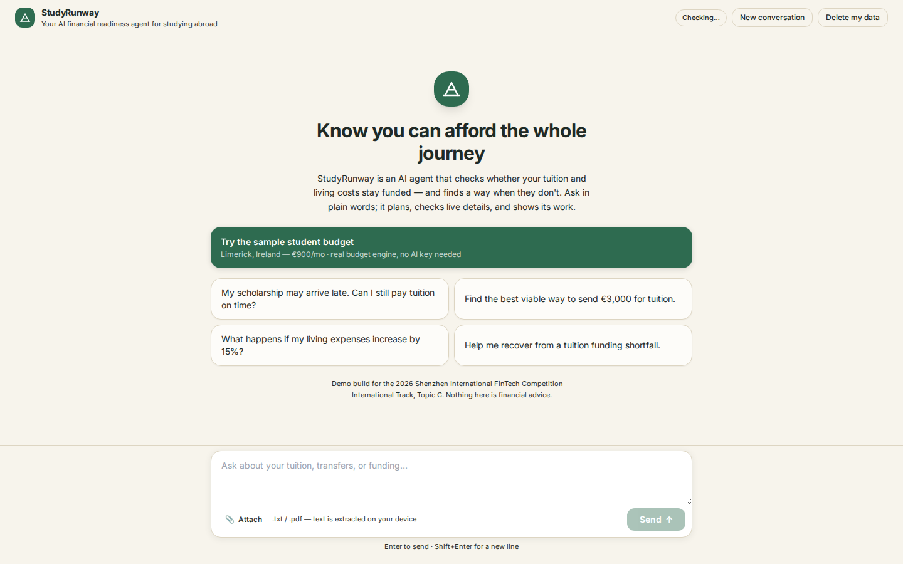
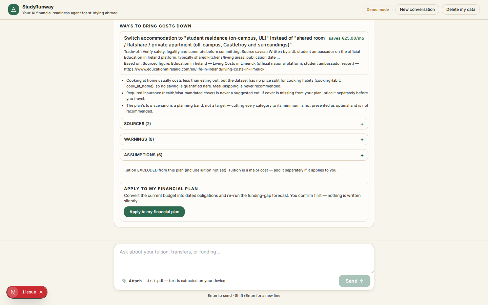
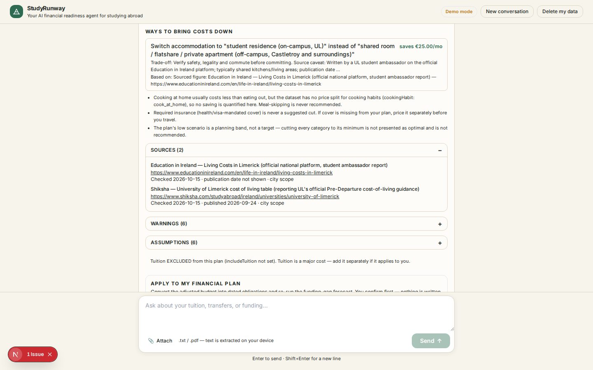

# StudyRunway — model-driven AI financial agent

FinTechathon 2026 · International Track · Topic C (Cross-border & Student Finance).


## Product screenshots

These are genuine UI captures from the running app, not mockups. The budget-planner captures were recorded on **15 October 2026**; the Income Shock Plan capture is from **20 October 2026**. Older captures show the cost engine workflow and should not be mistaken for proof of current hosted authentication or a live transaction. All figures are illustrative sample inputs.

<table>
  <tr>
    <td width="50%">
      <strong>Welcome / product entry point</strong><br>
      
    </td>
    <td width="50%">
      <strong>Destination budget result</strong><br>
      
    </td>
  </tr>
  <tr>
    <td width="50%">
      <strong>Source-attributed estimate</strong><br>
      
    </td>
    <td width="50%">
      <strong>Income Shock Plan — latest capture</strong><br>
      
    </td>
  </tr>
</table>

## Stack

Next.js 15.5.28 (pinned) · React 19.1.0 · TypeScript 5.7.3 · Tailwind CSS 3.4 ·
vitest 3.2.7 · Playwright 1.64.1 · three 0.182 + @react-three/fiber 9.4.2 + drei 10.7.7
(3D tool visualizer) · zod 3.24.2 (domain validation) · pdfjs-dist (local PDF evidence
extraction) · sharp 0.35.5.

## Local setup and Google sign-in

**Important:** Google sign-in is required to use StudyRunway, including its no-AI-key demo. The demo does not require an AI provider key, but it is not an authentication bypass.

For local development:

1. Copy `.env.example` to `.env.local` in the project root.
2. In [Google Cloud Console](https://console.cloud.google.com/), configure the OAuth consent screen and create an OAuth client ID with application type **Web application**.
3. Add this authorized redirect URI to the OAuth client: `http://localhost:3000/api/auth/callback/google`.
4. Set `AUTH_GOOGLE_ID` and `AUTH_GOOGLE_SECRET` in `.env.local` to the client ID and client secret. Generate a unique `AUTH_SECRET` for this environment. Leave `AUTH_URL` unset for local development.
5. Restart `npm run dev` and sign in with a Google account whose email is verified. If the OAuth consent screen is in Testing mode, add your account as a test user.

Keep `.env.local` out of Git and never commit OAuth secrets. These website sign-in settings are separate from AI provider credentials such as `GEMINI_API_KEY`. See [Google website sign-in setup](docs/SETUP.md#google-website-sign-in) for the full instructions and deployed callback URL.

## What's here

- `src/lib/` — the deterministic financial engine copied verbatim from the old
  build: minor-unit money arithmetic (`money.ts`), currency registry
  (`currency.ts`), zod domain model (`model.ts`), funding-gap forecast engine
  (`forecast.ts`), evidence-apply workflow (`evidence.ts`), transfer quote
  comparison (`transfers.ts`), scenario/stress engine (`scenarios.ts`),
  evidence CSV/plan exports (`export.ts`), PDF/text evidence extraction
  (`extract.ts`), sample plan fixture (`sample.ts`), and the deterministic
  action-agent layer (`agent.ts`). No old UI components, pages, or routes were
  carried over — the chat-first UI is built fresh in a later workstream.
- `.env.example` — placeholders only; includes `AI_PROVIDER=gemini`,
  `GEMINI_API_KEY`, `GEMINI_MODEL`, and the Google AI Studio-compatible base URL,
  plus optional xAI, OpenAI, and Anthropic settings. Server-side adapters support
  xAI, Gemini, OpenAI, and Anthropic. No API key is included. Without a real
  configured provider key, the app uses the clearly labelled deterministic sample workflow.

## Feature status: implemented vs. partial

This summary distinguishes working deterministic/local paths from features that depend on live providers or deployment configuration.

### Implemented in the codebase

- **Student-finance agent.** Understands finance requests, asks clarifying questions, plans steps, calls allow-listed tools, and verifies key calculations using deterministic engines. A labelled no-key demo is available.
- **Tuition funding and shortfall planning.** Combines dated costs with multiple funding sources, separates confirmed from expected/unverified money, and highlights gaps and upcoming obligations.
- **Crisis and income-shock planning.** Models delayed or reduced funding and other scenarios, recalculates the projected balance and earliest shortfall, and ranks dated recovery actions.
- **Destination living-cost planner.** Uses sourced ranges and adjustable assumptions where the dataset has coverage; exposes missing data instead of inventing estimates. Canada currently lacks typical living-cost coverage.
- **Overview dashboard and multi-currency cash flow.** Summarizes funding results, alerts and deadlines, and groups inflows and bills by currency. Any FX rate is labelled with its pair, date and source/assumption; unlike currencies are not silently added together.
- **Daily student budget and arrival-cost planners.** Track dated expenses and one-time moving/setup costs by category and currency without inventing prices.
- **Rental-payment safety review.** Highlights risk indicators and suggests verification steps; it cannot prove that a listing or landlord is fraudulent.
- **Financial document review.** Extracts candidate amounts, dates, currencies and supporting excerpts from text and text-extractable PDFs. Candidates require review/confirmation before they can be used; scanned-image OCR is not guaranteed.
- **Safe-to-Send safeguards.** Computes deterministic readiness and risk states, supports explicit approval for a reversible sandbox simulation, and provides decision evidence/receipt export. It does not send tuition payments.
- **Security controls and evaluations.** Google OAuth and verified-email checks, server-side route/session validation, tool allow-lists, input validation, identifier redaction and privacy-limited audit events are implemented. CI covers dependency resolution, typecheck, lint, unit/evaluation tests, build and Playwright flows.
- **Multilingual interface foundation.** The language selector supports English, Bengali, Simplified Chinese, Hindi and Spanish; shared UI text and the assistant language context are localized.

### Partial, conditional, or not live-verified

- **Transfer comparisons.** The chat comparison uses sample/reference data; users can enter provider quotes. The optional Wise preview is indicative only, not rate-locked or executable, and can omit receiving/intermediary charges. Other providers are not live-integrated.
- **Official finance, banking and credit research.** A Vertex Gemini Google Search grounding path with official-domain and citation checks is implemented, but a live check on 16 October 2026 returned no cited pages after three searches, so source-backed live answers were not verified at that check. The app withholds answers when citations fail its checks.
- **Live model quality.** Provider adapters and an opt-in Vertex smoke check exist, but CI mostly uses deterministic/scripted or mocked provider responses. Live response consistency, citation availability, quotas and credentials must be checked in the target environment.
- **Deep localization.** Some detailed planner controls and result cards can still show English text even when another assistant language is selected.
- **Persistence and sync.** The documented Cloud Run setup supports Firestore-backed server task state when configured; local development defaults to process-local memory. Browser transcripts, reminders, personal budgets and preferences are stored on that device and do not sync across devices.
- **Reminders and outbound actions.** Reminders are browser-local and notifications depend on permission and the app being open. Email is draft-only, not sent. No real payment rail is connected.
- **Production security posture.** The full dependency tree has not been cleared by a current audit, and the demo's route protections, rate limiting, provider configuration and storage still need deployment-specific review before real-user use.

For detail and exact boundaries, see [Feature Status](docs/FEATURE_STATUS.md), [Limitations](docs/LIMITATIONS.md), [Setup](docs/SETUP.md), and [Security Self-Assessment](docs/SECURITY_SELF_ASSESSMENT.md).

## Commands

```bash
npm install      # or npm ci (package-lock.json is committed)
npm run dev      # next dev
npm run typecheck # tsc --noEmit
npm run lint     # eslint .
npm test         # vitest run (unit + eval suite)
npm run e2e      # playwright test (chromium desktop + mobile 390px)
npm run build    # next build
```


### Troubleshooting: `Can't resolve 'next-auth/react'`

Auth.js is already declared in `package.json` and pinned in `package-lock.json`.
This error usually means the local dependencies are incomplete or the dev server
is running from a different checkout. In PowerShell, stop the dev server with
`Ctrl+C`, then run these commands from the folder containing `package.json`:

```powershell
Remove-Item -Recurse -Force .next -ErrorAction SilentlyContinue
npm ci
node -p "require.resolve('next-auth/react')"
npm run dev
```

The `node -p` command should print the resolved module path before you restart
the app. You can run `npm run check:runtime-deps` at any time to verify the Auth.js
client entry point is installed. Do not change the import or install a second
copy of Auth.js to work around a stale `node_modules` directory.

## Use Google AI Studio / Gemini

1. Copy `.env.example` to `.env.local` beside `package.json`.
2. Set `GEMINI_API_KEY` to your own key from https://aistudio.google.com/app/apikey.
3. Keep `AI_PROVIDER=gemini` and choose an available `GEMINI_MODEL` (default:
   `gemini-3.8-flash`). Leave other providers as `PLACEHOLDER` unless you intend
   to switch providers.
4. Restart `npm run dev`. The header must display `Google Gemini · <model>`.

Gemini is connected through Google's documented OpenAI-compatible endpoint for
chat completions and custom tool calls. Gemini-native tools such as Google Search
grounding are not provided by this compatibility adapter. API keys remain server-side.
See `docs/SETUP.md` for full instructions.

## Destination Budget Planner

The headline feature: a deterministic, source-attributed living-cost
engine for international students (`src/lib/livingCosts/`, dataset in
`docs/COST_DATASET.json` — researched costs for Ireland, Germany, Denmark,
UK, Australia; Canada is regulatory-minimum-only). The agent tool
`build_living_cost_plan` (registered in `src/lib/tools/`) renders the
interactive `living_cost_plan` result card: verdict, budget-vs-spending,
category breakdown with low/typical/high bands, adjustable assumptions
(accommodation, manually entered monthly food/transport costs, budget — each
supported change re-runs the real engine), sourced recommendations, visa requirements kept strictly
regulatory, and per-source freshness labels. With explicit confirmation the
plan converts to dated obligations (`/api/agent/budget-apply`) and feeds
the funding-gap forecast; `/api/agent/budget-revert` removes exactly what
was applied. See `docs/DESTINATION_BUDGET_DEMO.md` for the demo script,
`docs/DESTINATION_BUDGET_SPEC.md` for the engine spec, and
`docs/DESTINATION_BUDGET_RESEARCH.md` for the sources.

**Try it with no API key:** open the app, click **"Try the sample student
budget"** (welcome screen) — the demo runs the real engine on the verified
sample case (Limerick, Ireland — €900/mo, shared accommodation) through the
real tool path, honestly labelled. Or type any message and answer the
clarifying question it asks.

### Wise transfer quote preview

The transfer-comparison card can fetch an indicative Wise quote for display
when `WISE_QUOTES_ENABLED=true`. It shows the live rate, provider fees, payout
method, and ETA, and can add a selected option to the manual comparison. The
quote is not locked or executable, recipient-bank charges remain a separate
unknown, and other providers still require manually entered quotes. Wise quote
preview setup and Cloud Run instructions are in `docs/WISE_QUOTES_SETUP.md`.

## Judge-ready Funding Risk Agent (deterministic-first)

### Structured funding details

The Chat view also provides **Enter funding details**, an additive structured
form for multiple tuition/living costs and multiple savings, scholarship,
family, loan, or other funding sources. Each row retains its own amount,
currency, deadline, frequency, and availability status. Submission goes
directly to the validated `/api/agent/funding-check` route and the existing
deterministic forecast engine; it does not ask the model to parse financial
JSON and it never performs a transfer. Confirmed money, future confirmed
funding, and expected/unverified funding remain separate in the result.
After the deterministic result is shown, the form can request a separate
server-side explanation from the configured hosted Google Gemini/Vertex-Gemini
provider. The explanation receives a server-recomputed calculation summary,
cannot modify the result or trigger actions, and can be retried without
re-entering the form; if Gemini is unavailable, the deterministic result stays
visible. The submitted form also saves the same validated canonical plan to
the active agent session, so later scenario and recovery requests reuse the
baseline without asking the user to re-enter it.

StudyRunway now connects three deterministic capabilities into one workflow:

1. **Safe-to-Send** tuition decisioning (`READY_TO_SIMULATE`, `RISK_DETECTED`, `MORE_INFORMATION_REQUIRED`, `BLOCKED`)
2. **Funding Timeline** (expected/received/delayed/cancelled inflows + obligations + projected balance)
3. **Delay Recovery** (hypothetical delay/cancellation scenarios + earliest-shortfall + recovery assumptions)

Core implementation:

- Engine: `src/lib/safeToSend/engine.ts`
- Tool/actions + state transitions: `src/lib/tools/safeToSend.ts`
- API route: `src/app/api/agent/safe-to-send/route.ts`
- UI card: `src/components/results/SafeToSendDecision.tsx`

### Deterministic vs AI responsibilities

- **Deterministic server code (authoritative):** calculations, timeline projection,
  earliest-shortfall detection, Safe-to-Send status, stage transitions,
  approval validation, sandbox simulation apply/revert, and receipt export.
- **AI (optional):** natural-language understanding, clarification prompts,
  and explanation of deterministic outputs.

No AI response can authorize a simulation or override a decision status.

### Run the no-key demo (judge flow)

1. Open chat and click **Try the Safe-to-Send tuition demo**.
2. In the card, click **Load demo baseline**.
3. Review baseline timeline and earliest shortfall.
4. Apply **+7 days** delay on scholarship funding.
5. Review scenario shortfall and obligations at risk.
6. Apply a recovery assumption and recalculate.
7. Review **Why this decision?** and **Decision evidence**.
8. If status is `READY_TO_SIMULATE`, click **Approve and simulate**.
9. Review latest sandbox action and updated forecast impact.
10. Optionally **Revert latest simulation**.
11. Click **Download sandbox execution record** for a sanitized JSON receipt.

### Sandbox execution record export

- Endpoint: `GET /api/agent/safe-to-send?sessionId=...&simulationId=...&download=1`
- Returns only sanitized simulation/decision/forecast fields from recorded state.
- No API keys, secrets, or hidden prompts are included.

### Session and browser storage

On the configured Cloud Run deployment, authenticated agent task state is stored
in Firestore with request-level concurrency checks and expiry metadata. Local
development defaults to process-local memory unless the Firestore store is
configured. Browser-only transcripts, reminders, budgets, and preferences remain
in account-namespaced local storage on that device; they are not synced or backed
up to Firestore. See `docs/SETUP.md` and `docs/SECURITY_SELF_ASSESSMENT.md` for
the exact deployment boundary and remaining risks.

## Verification and submission evidence

The [GitHub Actions quality workflow](https://github.com/Rubai106/StudyRunway/actions/workflows/quality.yml) runs on pushes and pull requests. A verification run checks a clean `npm ci`, the `next-auth/react` runtime dependency, typecheck, lint, unit/evaluation tests, production build and Playwright E2E. Use the run page to confirm the exact commit SHA and test totals; numbers from an earlier run do not validate a newer revision. Most chat/provider tests are scripted or mocked and do not establish live-model quality, live research citations, hosted OAuth configuration or external quote availability.

For a real Vertex check, run `npm run verify:live-ai` with valid Google Cloud ADC/project/model configuration. This is separate from CI and may incur provider charges. A check on **16 October 2026** returned no cited official pages after three Google Search queries, so official-research citations should be confirmed in the target environment before relying on them.

**Dependency audit caveat:** a full-tree audit recorded on **19 October 2026** reported 15 findings (1 moderate, 12 high, 2 critical). A production-only audit on the tested Windows tree reported zero findings, but that does not clear development dependencies or establish the current full-tree status. Re-run `npm audit` on the release machine, inspect the dependency paths/advisories, and avoid `npm audit fix --force` without compatibility review.

The submission's Item 06 video records a **local demo-mode sandbox simulation**, using source revision `e213b84272d98b03b51807bd1e416bc4f0ad0933`; no real payment occurred. During the evidence review, the hosted entry point displayed a Google sign-in gate and anonymous agent API requests returned 401. The local video is not evidence of an authenticated hosted transaction or of the current deployed revision. The evidence manifest and checksums are in the Item 06 package.

For the submission checklist and evidence provenance, see [FinTechathon Submission Index](docs/FINTECHATHON_SUBMISSION_INDEX.md).
